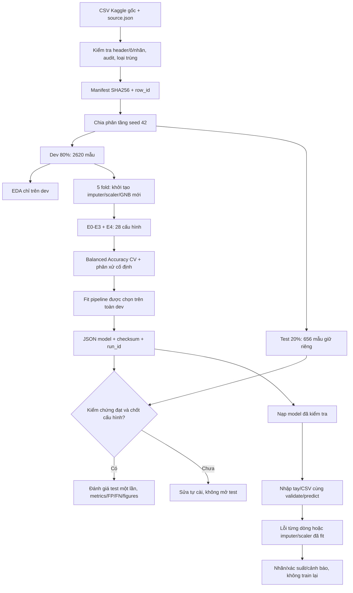

# Nghiệm thu triển khai Gaussian Naive Bayes

Ngày bắt đầu: 24/10/2026. Căn cứ: kế hoạch 1.3 và AGENTS.md.

## Quy ước theo dõi

- `[x]`: đã thực hiện và có bằng chứng được ghi bên cạnh hoặc trong nhật ký cuối file.
- `[ ]`: chưa hoàn thành hoặc chưa xác minh; có mã nguồn không đồng nghĩa kiểm thử đã đạt.
- Chỉ dùng bản tự cài, không sklearn, không thống kê/metric thư viện, không dự đoán giả.
- Không tự xác nhận yêu cầu giảng viên, đóng góp sinh viên hoặc khả năng chạy trên ba máy.

## 1. Chuẩn bị và hợp đồng chung

- [x] Đọc AGENTS.md và mục 0 của kế hoạch; kiểm tra Git, giữ nguyên thay đổi sẵn có.
- [x] Tạo checklist nghiệm thu chi tiết trước triển khai.
- [x] Chốt cấu hình tập trung: 9 cột, lớp, seed, smoothing, sàn phương sai, cảnh báo thiếu (`src/config.py`).
- [x] Kiểm tra Python/launcher; tạo .venv từ Python 3.12.3 có sẵn (launcher py đăng ký cũ không hoạt động).
- [x] Cài dependencies vào .venv và ghi phiên bản thực tế trong manifest dữ liệu/lần chạy.
- [ ] Xác nhận yêu cầu giảng viên, hạn nộp và phân công ba sinh viên (cần nhóm xác nhận).

## 2. Thuật toán tự cài

- [x] GNB: kiểm tra X/y, đủ hai lớp, prior, mean, phương sai MLE, epsilon theo kế hoạch.
- [x] Điểm log Gaussian, chuẩn hóa trừ max, predict/proba, hòa điểm chọn lớp 0.
- [x] Phát hiện lỗi số học, không trả nhãn giả; trạng thái lưu/nạp kiểm tra kích thước.
- [x] Tests đáp án độc lập hai thuộc tính, prior/variance/proba, cột hằng, lỗi API (bộ 287 tests số học/pipeline đã đạt).

## 3. Tiền xử lý và phép chia

- [x] Mean/median bỏ qua thiếu, từ chối cột thiếu toàn bộ; z-score ddof=0, scale hằng=1.
- [x] Fit/transform tách biệt, thống kê train không học validation/test.
- [x] Chia phân tầng 80/20 seed 42 và 5 fold tự viết, lưu ID chuẩn LF (`data/splits`, checksum trong manifest).
- [x] Loại trùng xác định trước chia; chặn nhóm cùng đầu vào khác nhãn, ghi audit/ID loại.
- [x] Tests tính tay imputer/scaler và bất biến phân tầng/fold/không giao nhau.

## 4. Dữ liệu và kiểm tra đầu vào

- [x] CSV UTF-8 header nguyên trạng, đúng tên/cột, giữ sample_id và số 0 đầu.
- [x] Phân biệt missing, chuỗi sai, vô hạn; giữ row_id/thứ tự và lỗi từng dòng.
- [x] Nguồn Kaggle version 3, giấy phép CC0 kiểm tra qua API công khai; tải CSV nguyên bytes, `data/source.json`.
- [x] Manifest SHA-256, audit và từ điển dữ liệu tại `data/README.md`; đơn vị chưa xác minh ghi rõ, không suy diễn từ ngưỡng tham khảo.
- [x] Tests header/token/sai nhãn/trùng/cột thừa và CSV trộn dòng hợp lệ/lỗi (57 tests CSV và tests prediction).

## 5. Đánh giá và thực nghiệm

- [x] TP/FP/TN/FN, accuracy, Balanced Accuracy, metric từng lớp, macro-F1, N/A tự tính.
- [x] ROC-AUC nhóm điểm hòa, baseline prior hằng AUC 0,5; tests tính tay độc lập.
- [x] CV mới trạng thái mỗi fold; E0–E3 và E4 28 cấu hình, ghi điểm từng fold (run `20261024-E4-local-v1`, chưa mở test).
- [x] Tổng hợp CV ddof=0, chọn cấu hình biên 0,005 và phân xử cố định, không bỏ fold lỗi (48 tests experiments).
- [x] Run `20261024-E4-reviewed-v3`: fit sau kiểm chứng 457 tests đạt; test đánh giá một lần, model/metrics/predictions/manifest cùng run_id.
- [x] Thực nghiệm CSV thật và phân tích FP/FN đã lưu; không điều chỉnh tham số/seed/ngưỡng theo test. Gói nộp cuối vẫn chưa chốt commit.

## 6. Lưu/nạp và dự đoán

- [x] JSON schema_version=1, tham số imputer/scaler/GNB, min/max, checksum và run_id.
- [x] Từ chối schema/trạng thái/checksum sai; không cộng epsilon hai lần; round-trip hai cấu hình.
- [x] predict dùng chung cho nhập tay/CSV, cảnh báo thiếu >=3 và ngoài min/max train.
- [x] Trả lỗi đúng dòng kể cả lỗi số học, nhãn/xác suất dòng lỗi để trống.
- [x] CLI huấn luyện/đánh giá/dự đoán có hướng dẫn README, guard xác nhận, checksum và bảo vệ ghi đè; hồi quy CLI đã đạt.

## 7. Trình bày và bàn giao

- [x] Streamlit tiếng Việt: nhập mẫu, CSV, cảnh báo học thuật rõ; AppTest 9 tests đạt. Nhánh kết quả test thật vẫn chờ đánh giá.
- [x] App không có model thì báo thiếu, không train khi bấm dự đoán, không dùng dữ liệu giả (AppTest chặn fit).
- [x] EDA tự tính bin/phân vị/tương quan, thư viện chỉ vẽ; kiểm thử dữ liệu nhỏ, hồi quy cột hằng thập phân.
- [x] Notebook gọi src, cả hai chạy từ đầu bằng nbclient trong .venv; notebook02 đã chạy nhánh evaluated v3, hiển thị 15 PNG và CV/test/baseline đã kiểm tra hash.
- [x] README và data/README đồng bộ lệnh chạy, nguồn, cấu hình, giới hạn.
- [x] Sơ đồ luồng huấn luyện/dự đoán ở cuối file; phản ánh dev/test và pipeline dùng chung.
- [ ] Báo cáo, slide, video/bảo vệ thử và xác minh trên máy khác (chỉ tick khi có bằng chứng).

## 8. Kiểm tra cuối

- [x] Agent chính đọc mã các phần được giao và tích hợp findings, có tests hồi quy.
- [x] `rtk proxy .\.venv\Scripts\python.exe -X utf8 -m pytest -q`: **457 passed in 43.25s**, sau khi agent ngừng sửa; pip check không báo lỗi.
- [ ] Quét import/lời gọi bị cấm, kiểm tra không trùng logic và không lộ secrets.
- [ ] Smoke test CLI và app; xác minh artifact/model/metrics khớp checksum.
- [ ] Cập nhật trạng thái từng mục và báo rõ phần chưa chạy, nguyên nhân và bằng chứng.

## Nhật ký và trở ngại

- Kiểm tra đầu tiên: chưa có `.venv`; lệnh `python --version` báo không tìm thấy Python trên PATH. Chưa kết luận máy không có runtime cho đến khi kiểm tra launcher/vị trí chuẩn.
- Git có README sửa và nhiều file bộ khung chưa tracked từ trước; không tự commit/push trong đợt triển khai này.
- 10:47 UTC: toàn bộ tests hiện có đạt 420; bổ sung kiểm thử điều phối train/evaluate bằng CSV tổng hợp đạt thêm 6 tests. Chưa mở test của dữ liệu Kaggle.
- Audit CSV thật: 3276 dòng, lớp 0=1998/lớp 1=1278, không trùng; thiếu ph=491, Sulfate=781, Trihalomethanes=162. Dev=2620, test=656. SHA256 CSV: `904004bde729bfe3d2e195f46343bceead09e32a0eb95bb8184e7e20e029b2bf`.
- CV E4 đã chọn mean, không chuẩn hóa, smoothing=1e-9, variance_floor=1e-12. Run còn trạng thái phát triển với mã nguồn chưa commit; chưa đủ điều kiện gói nộp cuối theo kế hoạch.
- Đợt sửa review: Pearson nhận diện hằng trước moments; nạp state kiểm tra fill mean và singleton MLE; 224 tests liên quan đạt. Thêm bảo vệ nguồn CSV, split vật lý, run ID/figures và CLI không ghi đè; kiểm chứng offset lớn cho pipeline chuẩn hóa.
- Đã chốt phiên bản dependencies trực tiếp trong requirements.txt theo môi trường thực tế; không phải lock toàn bộ dependency gián tiếp hoặc xác nhận trên máy khác.
- Run `20261024-E4-reviewed-v2` bị timeout ở lệnh shell sau 120 giây, không có run manifest hoàn tất; không dùng làm bằng chứng, không ghi đè thư mục. Run v3 thực hiện bằng tracked monitor và hoàn tất bình thường.
- Run `20261024-E4-reviewed-v3` đã evaluated sau 457 tests: cấu hình mean/no-scale/1e-9 giữ nguyên. Model SHA256 `c2c4755633e83ed3c3099dd9d4f19161fb4b59624d7be5b1c9fbbe583cb48b37`. Acceptance status phát triển, chưa phải gói nộp đã ký.
- Test 656 mẫu: accuracy=0.6067073171, Balanced Accuracy=0.531953125, macro-F1=0.5027032109, ROC-AUC=0.5495996094. Confusion [[349,51],[207,49]]; lớp 1 precision=0.49, recall=0.19140625. Baseline accuracy=0.6097560976, BA=0.5, AUC=0.5. Accuracy mô hình thấp hơn baseline; không tuyên bố mô hình tốt toàn diện hoặc nước an toàn.
- FP=51/400 mẫu thực tế nhãn0 (12.75%); 51/100 dự đoán nhãn1 là sai (51%); FN=207/256 mẫu nhãn1. Chi tiết tại `results/metrics/20261024-E4-reviewed-v3/error_analysis.json` và `test_predictions.csv`. Không dùng sai số này để chọn lại mô hình.
- Evaluate kiểm tra hash đầu ra CV/EDA trước inference, khóa OS, ghi checkpoint bền vững; retry render không suy luận lại. 24 tests integrity tổng hợp bao phủ lỗi checksum, seed khác mặc định, gián đoạn và publish một phần.
- Quét src/tests/app/notebooks không thấy sklearn hoặc aggregate NumPy/statistics bị cấm; app không có fit, notebook chỉ fit ví dụ tổng hợp tự cài. `git diff --check` đạt cho tracked changes, không thay kiểm tra các file untracked. Chưa hoàn tất audit secrets toàn bộ gói nộp nên mục quét tổng thể vẫn để mở.
- Kiểm tra sau evaluate: 24 file trong manifest v3 khớp SHA256, model/sidecar/run_id và CSV/data manifest khớp. Notebook02 thực thi 7 cells trong bộ nhớ, nhánh evaluated hiển thị thật; hash notebook/manifest/24 file không đổi. AppTest nạp model thật, chặn fit/predict/proba trong smoke load, không có exception/error; chưa thay cho thử upload thủ công trong browser.
- Theo yêu cầu người dùng ngày 24/10/2026: chuẩn bị commit/push toàn bộ mã, notebook, dữ liệu CC0, phép chia, model và kết quả; loại môi trường ảo/cache/secrets/file khóa. `.gitattributes` giữ bytes của artifact có SHA256. Kiểm thử lại trước commit: 457 passed in 54.88s. Không sửa metadata `dirty=true` của lần chạy quá khứ thành trạng thái sạch chỉ vì commit sau đó.

## Luồng thực thi

